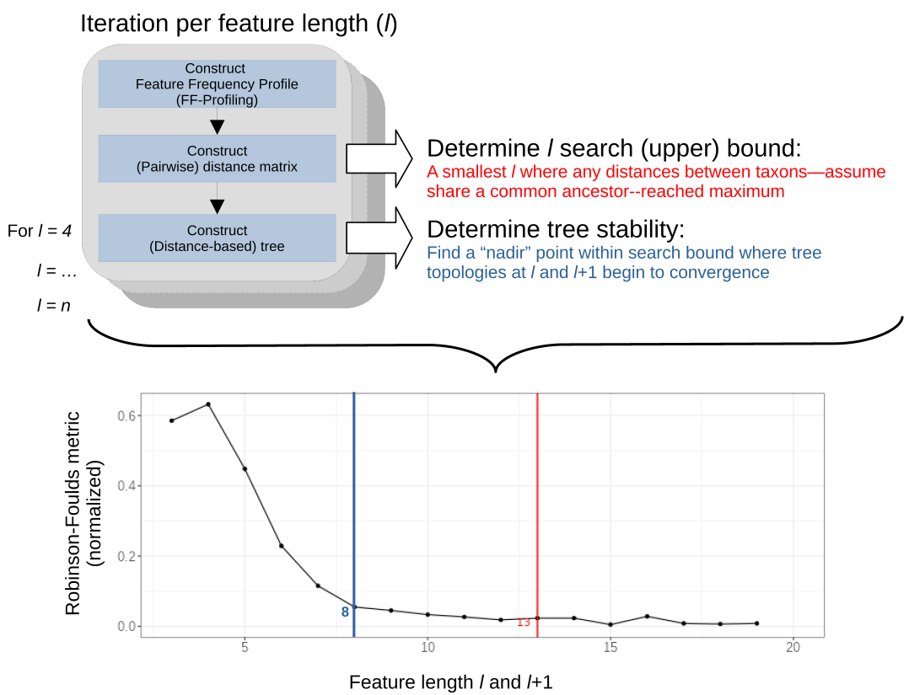

# Tutorial

## On dataset

All 600 proteome data are obtained from NCBI RefSeqDB that the corresponding whole genome assembly is categorized to either "reference genome" or "representative genome", and their assembly levels or qualities are equal or better than "scaffold".

For convenience the dataset is preprocessed and compressed in .zip file, where each proteome data is store in a FASTA file named in unique NCBI taxonID (and for tree leaf names). In addition, any organelle-derived sequences (e.g., mitochondrion or chloroplast) are removed during preprocessing.

## Logistic

For this tutorial, the version "" is used. All core programs are developed to use in a command-line environment or terminal (e.g., Linux, or Cygwin for Window). A whole steps will be done in your current working directory.

For convenience, you can run locally with a provided (Python) wrapper script to automate series of steps, including FF-Profiling, distance matrix constructing, tree building and result summarizing, Or, see two core commands to adopt in your working environment, such as cluster compute environments.

Please (click to) copy, paste, and execute code blocks in your terminal.

## Download and preprocess dataset

### 1. Download two required files

* One spread sheet listing 600 proteome FASTA files in NCBI FTP depository
* One python wrapper to download FASTA files and preprocess

```console {check the github file location}
wget https://raw.githubusercontent.com/jaejinchoi/FFP/refs/heads/master/example/600_tutorial_proteome/ncbi_ftp_download.py
wget https://raw.githubusercontent.com/jaejinchoi/FFP/refs/heads/master/example/600_tutorial_proteome/600-taxons_NCBI-proteome-source.xlsx
```

### 2. Download 600 FASTA proteome files using the provided python wrapper

* All donwloaded FASTA files named in TAXID and stored in the "600-proteome-in-taxid" folder

```console {download 600 proteome FASTA files from NCBI FTP, and save to the folder, '600-proteome-in-taxid'}
python ncbi_ftp_download.py -S 600-proteome-in-taxid -d ./600-taxons_NCBI-proteome-source.xlsx
```

<br>

## Two core commands

### 1. Construct Feature Frequency Profile (FFP)

* -a; input is proteome (amino acids)
* -s 8; Feature length (_l_) of 8
* -n; normalize feature counts into frequencies
* Output folder is "./ffp_8", manually created  
* Manually create output folder, "./FFP_4"

```console
mkdir ./ffp.4
./FFP_bin_2v.4 -a -s 8 -n 600-proteome-in-taxid/8407 ./ffp.8/8407
./FFP_bin_2v.4 -a -s 8 -n 600-proteome-in-taxid/373903 ./ffp.8/373903  
./FFP_bin_2v.4 -a -s 8 -n 600-proteome-in-taxid/1794699 ./ffp.8/1794699  
```

Do for each file for each feature length (_l_)...

### 2. Construct (symmetric) distance matrix, of Jensen-Shannon Divergence

* -T: using tab as a separator of taxon names and the distance values. Taxon names fixed to first 10 characters by default (trimmed if exceed).
* -t 3: using 3 threads or cores
* -s: Print full square distance matrix (lower triangular matrix by default) since some tree building programs require fully square distance matrices
* The output is printed to screen, thus, '>' captures printed results to the following file path, here, save to "matrix.fp_8"

```console
./JSD_matrix_bin_2v.4 -T -s -t 3 ./FFP_8/* > matrix.fp_8
```

<hr>

<br>

## Python wrapper to automate iteration

Essentially, the wrapper script automate iteration of searching feature lengths. Please check if you have downloaded and compiled core programs. And provided python wrapper is largely dependent on standard packages need not to install; however, need some extra packages for core functions. Required packages can be easily find and install using PIP.

* Python 3.12+ _# check the version with --version_
* Pandas _# read distance matrices and summarize results_
* Matplotlib _# plotting using pandas.dataframe()_
* Dendropy _# build and compare trees_

```console
pip3 install pandas matplotlib dendropy
```

Once requirements are met let's create new folder for tutorial, jump in, and download the wrapper script.

```console
mkdir ./ffp_tutorial
cd ./ffp_tutorial
wget https://raw.githubusercontent.com/jaejinchoi/FFP/refs/heads/master/example/ffp_wrapper/ffp_wrapper.py
python3 ffp_wrapper.py --help
```

You should see the wrapper script's arguments (per subcommand) and options available (--help). Move compiled core programs and unzipped dataset folder to the tutorial working folder, "./ffp_tutorial".

Now let's iterate/search feature length from 4 to 12, given proteome FASTA files, with conditions.

* Input proteome FASTA files, in "600-proteome-in-taxid"
* FF-profile feature length (_l_)=4-12: -s 4 -e 12
* Pairwise distance matrix, in Jensen-Shannon Divergence (JSDiv): --parg "-d jsdiv"
* Normalize tree distances when plotting: --rf_norm

A whole process will proceed, passed through three subcommands: "profile" -> "distance" -> "optimum"

```console
python3 ffp_wrapper.py profile -S ./ffp_proteome -s 4 -e 12 --ppath [path_to]/FFP_bin_2v.4 --parg "-a -n" 600-proteome-in-taxid/*

python3 ffp_wrapper.py distance -S ./ffp_proteome -f --ppath [path_to]/JSD_matrix_bin_2v.4 --parg "-d jsdiv" ./ffp_proteome/fp.*

python3 ffp_wrapper.py optimum -S ./ffp_proteome --rf_norm ./ffp_proteome/distance_matrix/matrix.jsdiv.*
```

### On tree construction

Construct Neighbor-Joining (NJ) tree using Dendropy package by default, but you may want to use external tree building programs that take a distane matrix (e.g., BIONJ; <http://www.atgc-montpellier.fr/bionj/>). To do so, use --tree_ppath [path_to_program] and --tree_parg [arguments_to_pass], then, it will execute a command in this format:
> [path_to_program] [arguments_to_pass] [input_path] [output_path]

<br>

## Workflow

Search and increment _l_ until reaches to upperbound where a distane between any two taxons reached maximum (e.g., Jensen-Shannon Divergence maximum is 1.0), which assumes those taxons share a common ancestor (either in- or out-group).

If outgroup is composed of artificially generated taxons and have no _evolutionary relatationship_ to _natural_ taxons, then, all distances from outgroup to ingroup should be maximum; therefore, such a point of _l_ act as lowerbound of optimal _l_ search

Upperbound is practically more important in defining search boundary because not all studies include artifical taxons (outgroup) for tree rooting and the fact lowerbound is hard-capped (to _l_=1).

